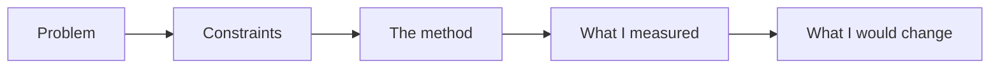

# Product Portfolio

Case studies and prototypes for **product owner, product manager, front-end and design roles**, built from real work on my own projects. Each one shows how I find the problem, decide what to build, make it something you can see, and check whether it worked, with the numbers in the open. My background is quality assurance, which is why I care about risk and measurement. No made-up users and no borrowed company data: where a piece needs real people (user research), it waits until I have real, consented interviews.

> [!TIP]
> **If you have five minutes**, read these two. Each takes four to five minutes and ends with what I would change:
>
> - [**Prioritizing a backlog of 570 ideas with one person's time**](case-studies/01-prioritizing-the-ideas-plan.md): How a list of 843 entries became 570 real ideas, and how I keep the progress number honest
> - [**Deciding what to test when time is short**](case-studies/02-deciding-what-to-test-when-time-is-short.md): A five-part rule, a four-line release summary, and a measurement that surprised me

## Overview

Hiring for a product or design role? This table shows which piece speaks to which role. **What exists today:** two case studies, one on product owner and product manager work and one on quality and risk. **What is planned:** the front-end and design pieces, starting with a prototype you can click, then the rest of the product pieces.

## Roles This Portfolio Speaks To

| Role | What to look at | Status |
|---|---|---|
| Product owner | [Prioritizing a backlog](case-studies/01-prioritizing-the-ideas-plan.md); a requirements document with acceptance criteria | Study 1 done; requirements document planned |
| Product manager | The same backlog study; a metrics case study; user research | Metrics and research planned |
| Front-end developer | A clickable prototype built in HTML and CSS, with the code | Planned |
| Designer | A teardown of a public app; a prototype with a plan to test it with users | Planned |
| Quality and risk, for any role | [Deciding what to test when time is short](case-studies/02-deciding-what-to-test-when-time-is-short.md): how I decide, and how I tell people what was not covered | Study 2 done |

## How the Studies Are Told

A product decision is a choice with a cost: what to build first, what to leave out, what to check before shipping. Each case study shows one real choice, in the same order every time:

## At a Glance

| | Study 1 | Study 2 |
|---|---|---|
| **Topic** | Prioritizing a backlog | Choosing what to test |
| **The decision** | What to build first with too little time | What to check before a release ships |
| **The key number** | 843 entries became 570 real ideas | A smoke run makes 75% fewer test runs, but is not faster |
| **What it shows** | Sorting by fit, size and dependency; honest progress | Risk-based choices; saying what was not covered |
| **Read time** | About 5 minutes | About 4 minutes |

- 2 case studies so far, with more on the way (see [coming next](#coming-next))
- Real numbers from my own work, each traceable to a plan or a public repository; a rule of thumb is labelled as one
- Every study ends with what I would change, not only what went well
- A [check](.github/scripts/check-readme.mjs) that stops this page from linking to a missing file or forgetting a new case study

## The Case Studies

### 1. Prioritizing a Backlog of 570 Ideas

*About 5 minutes. Shows how to sort by fit, size and dependency, and how to track progress honestly.*

**The question:** How do you decide what to build when one person has far more ideas than time?

**The short answer:** Clean the list first (843 entries became 570 real ideas), then sort on three questions that can be answered from a title, and track progress in a way that shows when the list grows faster than the work.

**[Read the case study](case-studies/01-prioritizing-the-ideas-plan.md)**

### 2. Deciding What to Test When Time Is Short

*About 4 minutes. Shows risk-based choices, and how to tell a decision maker what was not covered.*

**The question:** A release is ready and the time to test it is fixed. What gets tested first, and what do you tell the person who decides to ship?

**The short answer:** Critical flows first, a rough 60/30/10 split of the time, one whole workflow before the next, and a four-line summary that says what was not tested. The same idea runs as code in a public project, where a measured surprise changed what I would claim for it.

**[Read the case study](case-studies/02-deciding-what-to-test-when-time-is-short.md)**

## How Each Study Is Built

| Part | What it answers |
|---|---|
| Problem | What was wrong or unknown, in everyday words |
| Constraints | Time, people, money and rules I could not change |
| The method (headed "What I did" or "The rule I use") | What I did and why, not only the result |
| What I measured | Numbers, where they came from, and anything that surprised me |
| What I would change | Honest weaknesses and the next test |

## Coming Next

Added one piece at a time; this page is updated with each one. The order follows the roles above: design and front end first, because they are things you can see and click.

- **Front end:** A clickable prototype built in HTML and CSS, with the code and a note on the choices I made
- **Design:** A teardown of one public app: what works, what does not, what to improve, with annotated screenshots
- **Product owner:** A requirements document for one feature: problem, goals, success measures, user stories, acceptance criteria, edge cases
- **Product manager:** A metrics case study: a North Star metric, a funnel, and how to investigate a metric drop
- **Product manager and design:** A user research study, once I have five real, consented interviews

## Words Used on This Page

| Term | Meaning |
|---|---|
| Prioritization | Deciding what to do first, and what not to do |
| Smoke test | A short check of the most important paths, run first because it is fast |
| Regression test | A test that checks something that used to work still works |
| Tier | A group of items with the same importance: critical, medium or low |
| North Star metric | The one number that best shows whether the product is delivering value |
| Funnel | The steps people go through, with how many drop out at each step |
| Acceptance criteria | The conditions a feature must meet to count as done |

## Related Work

The test automation work behind these studies is in [qa-automation-platform](https://github.com/rizvihiqrar/qa-automation-platform), and my courses and lesson plans are in [training-portfolio](https://github.com/rizvihiqrar/training-portfolio).
