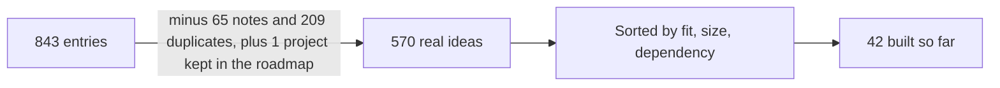

# Organizing Ideas

**Role:** Product owner of my own portfolio. **How it is kept:** Built in one housekeeping session, then its tracker is updated at the end of every build day. **Result so far:** 42 of 570 ideas built (7.4% of the whole list), every one in a public package with tests. In the test automation group I am building first, 29 of 171 numbered ideas are built (17%). Why 7.4% is not the number to chase is in [Is 7.4% a good result?](#is-74-a-good-result).

| At a glance | |
|---|---|
| The question | What do you build first when one person has far more ideas than time? |
| The method | Clean the list, sort on fit, size and dependency, bundle the small ones, date milestones not items |
| The key number | 843 entries became 570 real ideas |
| The honest part | Adding ideas lowered the percent done, and I left it that way |
| Read time | About 5 minutes |

## The Problem

Over a few weeks I collected ideas from job postings, courses, posts other people shared, and my own gaps. The list reached 843 entries. I build one small piece a day, so the list was a promise I could not keep in its raw form: nothing in it said what to build next, what to skip, or how far along I was.

## Constraints

- One person, one build day at a time. I decided on one roadmap day per calendar day, with at most two small bundles of ideas counted as one day.
- A weekly usage limit on the AI coding assistant I build with, so big days must be rationed too.
- At most two pull requests in CI at once, so the order matters, not only the total.
- Free tools only. Nothing that needs a paid cloud account, a graphics card or a settings change I would have to make for someone else.
- Everything public. No employer material, no private data, no figures I cannot verify.

## What I Did

**1. Cleaned the list before ranking it.** Of the 843 entries, 65 were notes or sub-points of another idea and 209 were near-duplicates of another entry. That left 570 distinct ideas. Ranking duplicates would have counted the same work twice and made the percent done look better or worse than it was.

**2. Sorted three ways, not scored.** I did not build a numeric score. I sorted on three questions that I can answer from the title and description:

| Question | Values | Why it matters |
|---|---|---|
| Who is it for? (tier) | 1 test automation roles, 2 adjacent quality, data and security roles, 3 other roles | My target roles come first. The same effort on tier 1 is worth more to me than on tier 3. |
| How big is it? | Small (one session, one package), Medium (needs a new tool or a package of its own), Large (several stages) | Decides whether it fits a day, and which model and how much usage it needs. |
| Does it depend on something I do not control? | Money, a setting only I can change, real people | These wait; they are not dropped. |

Remaining work today: 120 Small, 372 Medium, 36 Large. By tier: 150 / 153 / 227.

**3. Bundled the small ones.** Two or three Small ideas that touch the same package go into one pull request, so setup cost is paid once. There are 45 Small bundles to build, 115 Medium bundles for tier 1 and 2, and an undated backlog of Medium bundles for tier 3 that I pick from only when a posting asks for one.

**4. Set dates by milestone, not by item.** A milestone is a group of bundles with a "done by" date, for example the first ten Small bundles by one Friday. A date per idea would break every time something changed; a date per milestone moved once.

## What I Deliberately Did Not Build

| Left out | Reason |
|---|---|
| More packages for breadth | A hiring-style review of my own repositories said it already reads wide, and the gap was depth. I chose to go deeper on existing packages. |
| A multi-account cloud landing zone, a full Kubernetes cluster on a cloud provider | Each needs a paid account. A small local version teaches the same testing skill. |
| Fine-tuning a model | Needs a graphics card or paid compute. The testing ideas around it (a regression gate, an eval set) are in the plan instead. |
| Repeating pay figures from marketing posts | I cannot verify them, so they are not quoted anywhere. |

## How I Know It Is Working

- **Percent done**, from a tracker updated at the end of every build day. It started at 7.7% on 10 November before the latest additions.
- **It stays honest when the list grows.** On 10 November I added 46 entries from six new sections. After merging 13 duplicates and filing 8 as notes, the distinct count rose from 545 to 570 and the percent done fell from 7.7% to 7.4%. A tracker that only goes up would have hidden that the backlog grew faster than I built.
- **Date changes.** When the plan moved on 5 November, 194 dates shifted by one working day, done by script. I record every change in the plan with its reason.

## Is 7.4% a Good Result?

Not by itself, and it is not meant to be 95%. The list holds far more than I can build before the plan ends in June 2027, on purpose: ideas for roles I am not aiming at first are only built when a posting asks for one. A score of 95% would mean building everything, including the ideas I decided to leave alone. That would be a worse plan, not a better result.

Two numbers say more:

- **The group I am building first.** 29 of the 171 numbered ideas for test automation roles are built (17%). The dated plan finishes the small and medium ones by 11 February 2027 and the large ones by 18 June 2027.
- **Keeping my own dates.** Dates are the one thing I control, so this is where a 95% target fits: at least 95% of the bundles due by a date should be finished by it. I have not measured this for this plan yet; it is a separate question from how my projects at work finished. I would start now, and publish the figure here.

## What I Would Change

- The sort is easy to explain but it is not a score, so two Small tier 1 ideas are ordered by gut feel. A simple score (fit times size, minus dependency risk) would make the order defensible. I would try it on one milestone and compare with what I would have chosen.
- Thirteen sections of ideas (119 to 131) are still unnumbered. I counted the gap in the tracker instead of hiding it, but a rule that every new idea gets an ID and a size the day it is written down would stop the gap from opening again.
- Sizes are a first pass from titles. Some Medium ideas will turn out Small once I look at the package they reuse, so the Medium total is probably too high. I re-check each bundle's size on its build day.

## Decisions It Supports

Next build day, I take the next bundle in order. When a job posting names a tool I have not used, I find its idea, size it, and move it up only if it is tier 1. Anything that needs money or a setting waits for me to decide, and the plan says so.
