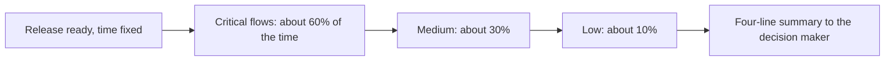
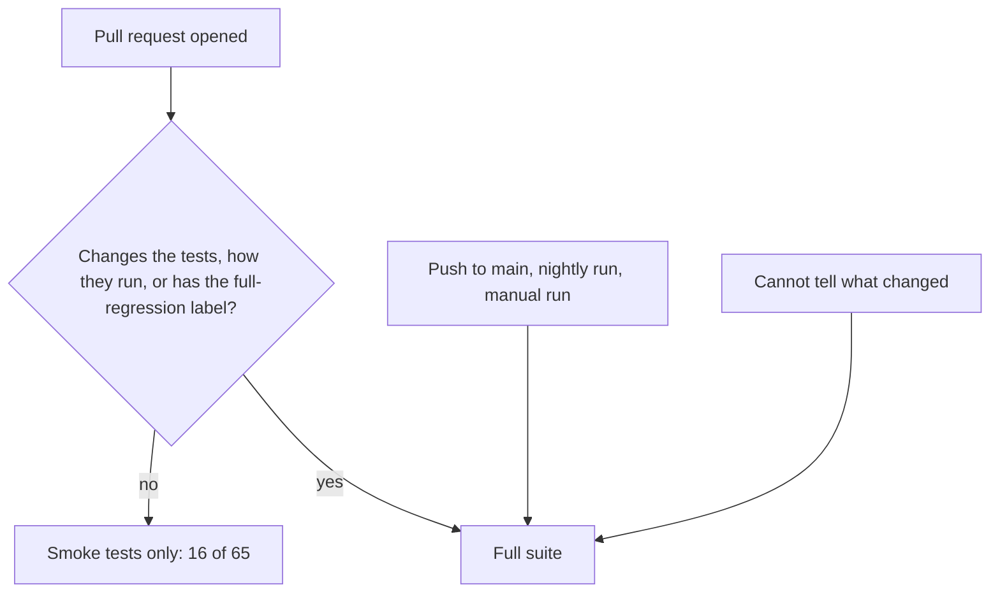

# Deciding What to Test When Time Is Short

**Role:** Tester and release checker. **Question:** A release is ready, the time to test it is fixed, and everything cannot be tested. What gets tested, in what order, and what do I tell the person who decides to ship?

| At a glance | |
|---|---|
| The question | What do you test first when time is fixed, and what do you tell the person who decides to ship? |
| The rule | Critical first, about 60/30/10 of the time, one whole workflow before the next, raise known problem areas, lead with what changed |
| The surprise | Smoke runs make 75% fewer live-site test runs, but are not faster |
| The output | A four-line release summary |
| Read time | About 4 minutes |

## The Problem

Every release has more things to check than hours to check them. Without a rule, the order depends on who is testing and how they feel that day: easy items first, familiar items first, or whatever was in the last release's notes. The risk is quiet. The item nobody got to is the one that breaks in production, and nobody knew it was skipped.

## Constraints

- Time is fixed. A release date does not move because the checklist is long.
- The checklist grows with every release and never shrinks.
- The person deciding to ship reads a summary, not the test steps, so the summary has to say what was not covered.

## The Rule I Use

It is a rule of thumb from release testing I have done, and it has five parts:

1. **Critical path first.** Start with the flows that touch revenue or the core business process. If these break, the release is not shippable whatever else passes.
2. **Split the time, roughly 60 / 30 / 10.** About 60% of the time on critical items, 30% on medium, 10% on low. For a large release, that looked like about 4 to 6 hours critical, 2 to 3 medium and 1 to 2 low.
3. **Finish one whole workflow before starting the next.** A complete order cycle from start to finish finds bugs between steps; ten half-checked flows find none of them.
4. **Raise known problem areas.** Anything named in a bug report or that failed last time moves up to critical.
5. **Lead with what changed.** The release notes say where the risk is; start there inside each tier.

## Where the Rule Shows Up in Code

I built the same decision into my public test project, [qa-automation-platform](https://github.com/rizvihiqrar/qa-automation-platform). A small script, `scripts/test-scope.mjs`, decides whether a change gets a quick smoke set of tests or the whole suite:

- A pull request runs only the smoke tests, 16 of the 65 browser tests.
- It runs everything instead if the change touches the tests themselves, changes how the tests are run, or carries a `full-regression` label.
- Pushes to the main branch, the nightly run and manual runs always run everything.
- When the script cannot tell what changed, it runs everything. The script's own comment says why: running too much costs a minute, running too little lets a broken test merge.

That is parts 1 and 4 of the rule in a simple form: the small critical set (the smoke tests) always runs, and a change that touches the tests, or a label I add, moves it up to the full run. The last bullet is a different idea, not one of the five parts: a safe default for when the script cannot tell.

The figures below come from the project's [technical guide](https://github.com/rizvihiqrar/qa-automation-platform/blob/main/TECHNICAL.md) and the script [scripts/test-scope.mjs](https://github.com/rizvihiqrar/qa-automation-platform/blob/main/scripts/test-scope.mjs), as they stood on 2026-11-10. They will change as the project grows.

## What I Measured, and What Surprised Me

I expected smoke runs to be faster. They are not. A smoke run makes 75% fewer test runs against the live site, but it is not quicker to finish, because the performance job (about 60 seconds) is the slowest part either way. What the rule really buys is fewer runs against a public site that can be slow or flaky.

That matters for the decision: if I had pitched this as a speed improvement it would have been wrong. The honest benefit is less noise, and I would say so.

## What I Tell the Person Deciding to Ship

A release summary of four lines, written every time. This is how it looks (example wording, not a real release):

| Line | What it says | Example |
|---|---|---|
| 1. Tested | What I tested, by tier | Critical: done. Medium: done. Low: partly done. |
| 2. Not tested | What I did not test, and why | Two low-priority screens, not reached: time ran out. |
| 3. Found | What I found, and which findings block the release | One medium issue, does not block. |
| 4. Recommend | My recommendation, and the one thing that would change it | Ship. If the medium issue turns out to affect payments, hold. |

Line 2 is the one that earns trust. It turns a quiet risk into a decision someone makes on purpose.

## What I Would Change

- The 60 / 30 / 10 split is a rule of thumb. I have not measured it. To check it, I would count bugs that escaped to production by tier. If critical items rarely escape and low items often do, the split is right; if the reverse, it is wrong.
- Tiers are assigned by judgment. Writing the reasons next to each item would let someone else challenge them.
- The four-line summary is not yet a template anyone else uses. I would try it on two releases and ask the readers what was missing.
