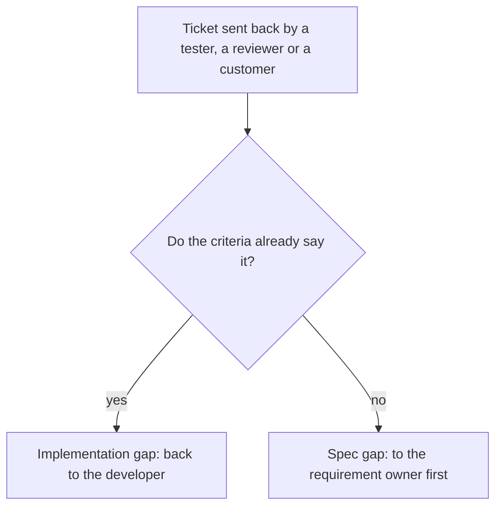

# Ticket Triage: Full Version

The longer version of the case study: the rule, the flow, the sample tickets and the limits. Every ticket, name and number here is made up to show the idea; none comes from a real project or employer.

## The Question

A ticket comes back from testing marked "rejected". Before anyone fixes anything, someone has to decide whose job the fix is. There are two honest answers, and they look the same on the board:

- **The requirement was missing something** (a spec gap). The developer built what was written. The fix starts with the owner.
- **The build missed something that was written** (an implementation gap). The requirement was fine. The fix starts with the developer.

Mixing them up wastes a round trip. A spec gap sent to the developer comes back unchanged. An implementation gap sent to the owner delays a fix that was already clear.

## The Rule

Ask one question of every rejected ticket: **do the written acceptance criteria already say what the tester expected?**

- Yes: the build is wrong. Label it an implementation gap, quote the failing criterion, and send it back to the developer.
- No: the criteria are incomplete. Label it a spec gap, write the missing criterion, and send it to the owner. The owner decides whether to add it to this ticket or log it as a new request.

The question does not ask who is at fault. It asks where a sentence is missing, which keeps the conversation about the page and not about people.

## The Flow



## Six Sample Tickets

These are made up, for a report export feature in an imaginary app.

| Sample ticket | Who sent it back | Criteria say it? | Label | Why |
|---|---|---|---|---|
| Export button does nothing | Tester | Yes | Implementation gap | The criteria say the button exports a CSV file. It does not. |
| Export has no totals row | Tester | No | Spec gap | The criteria never mention totals. The developer built what was written. |
| Dates show in the wrong format | Reviewer | Yes | Implementation gap | The criteria say dates are shown as year-month-day. |
| Customer expected a PDF | Customer | No | Spec gap | The criteria say CSV. The wish is new, so the owner adds it or logs a new request. |
| A large file freezes the export | Tester | No | Spec gap | Nothing says how many rows it must handle. Ask the owner for a number, then test against it. |
| Columns are in the wrong order | Reviewer | Yes | Implementation gap | The criteria list the column order. |

## The Prompt

The same rule written for an AI helper, so the label and the missing line come out the same way each time:

```prompt
Here is a rejected ticket and its acceptance criteria.
1. Quote the criterion the build breaks. If there is none, say "no criterion".
2. If a criterion is broken, label it an implementation gap and say what to fix.
3. If none is, label it a spec gap and write the missing criterion.
```

## What I Do Not Know

- Whether it shortens the time a ticket spends in "rejected". I have not measured it.
- Whether a team accepts the labels. A label that feels like blame will be argued with, however it is worded.
- How many real tickets are neither: a vague criterion is a spec gap that looks like an implementation gap. The rule treats them as spec gaps and asks the owner to tighten the sentence.
- Whether a freeze or a slow page is really a spec gap. A person can fairly call it a defect. The rule files it as a spec gap only because no criterion gives a limit; once the owner writes one (for example, ten thousand rows in five seconds), the next failure is an implementation gap.

## What I Would Change

- Count each label for a few releases, to see whether the same spec gaps repeat and which requirements need a template.
- Ask the owner to add every missing criterion to the ticket, not only answer the question.
- Try the prompt on ten real rejected tickets and note where its label differs from a person's.

## Related Piece

In the training portfolio, [Git for New Testers](https://rizvihiqrar.github.io/training-portfolio/04-technical-enablement/git-workflow-guide/) covers how a change is sent for review. A pull request that is sent back is a ticket rejected in code, and the same question applies: does the written description already say it?
