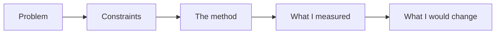

# How This Portfolio Works

Which piece speaks to which role, how each study is built, and what is planned next. Real numbers from my own projects; where a piece needs real people, it waits for real, consented interviews.

## Overview

Hiring for a product or design role? This table shows which piece speaks to which role. **What exists today:** two case studies, one on product owner and product manager work and one on quality and risk. **What is planned:** the front-end and design pieces, starting with a prototype you can click, then the rest of the product pieces.

## Roles This Portfolio Speaks To

| Role | What to look at | Status |
|---|---|---|
| Product owner | [Prioritizing a backlog](../case-studies/01-prioritizing-the-ideas-plan.md); a requirements document with acceptance criteria | Available now; requirements document planned |
| Product manager | The same backlog study; a metrics case study; user research | Metrics and research planned |
| Front-end developer | A clickable prototype built in HTML and CSS, with the code | Planned |
| Designer | A teardown of a public app; a prototype with a plan to test it with users | Planned |
| Quality and risk, for any role | [Deciding what to test when time is short](../case-studies/02-deciding-what-to-test-when-time-is-short.md): how I decide, and how I tell people what was not covered | Available now |

## How the Studies Are Told

A product decision is a choice with a cost: what to build first, what to leave out, what to check before shipping. Each case study shows one real choice, in the same order every time:

## How Each Study Is Built

| Part | What it answers |
|---|---|
| Problem | What was wrong or unknown, in everyday words |
| Constraints | Time, people, money and rules I could not change |
| The method (headed "What I did" or "The rule I use") | What I did and why, not only the result |
| What I measured | Numbers, where they came from, and anything that surprised me |
| What I would change | Honest weaknesses and the next test |

## Coming Next

Added one piece at a time; this page is updated with each one. The order follows the roles above: design and front end first, because they are things you can see and click.

- **Front end:** A clickable prototype built in HTML and CSS, with the code and a note on the choices I made
- **Design:** A teardown of one public app: what works, what does not, what to improve, with annotated screenshots
- **Product owner:** A requirements document for one feature: problem, goals, success measures, user stories, acceptance criteria, edge cases
- **Product manager:** A metrics case study: a North Star metric, a funnel, and how to investigate a metric drop
- **Product manager and design:** A user research study, once I have five real, consented interviews

## Words Used on This Page

| Term | Meaning |
|---|---|
| Prioritization | Deciding what to do first, and what not to do |
| Smoke test | A short check of the most important paths, run first because it is fast |
| Regression test | A test that checks something that used to work still works |
| Tier | A group of items with the same importance: critical, medium or low |
| North Star metric | The one number that best shows whether the product is delivering value |
| Funnel | The steps people go through, with how many drop out at each step |
| Acceptance criteria | The conditions a feature must meet to count as done |

